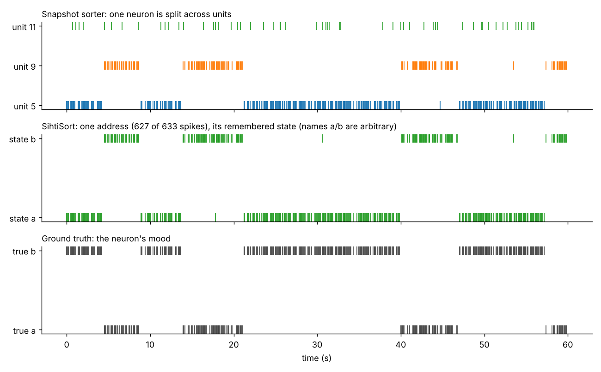
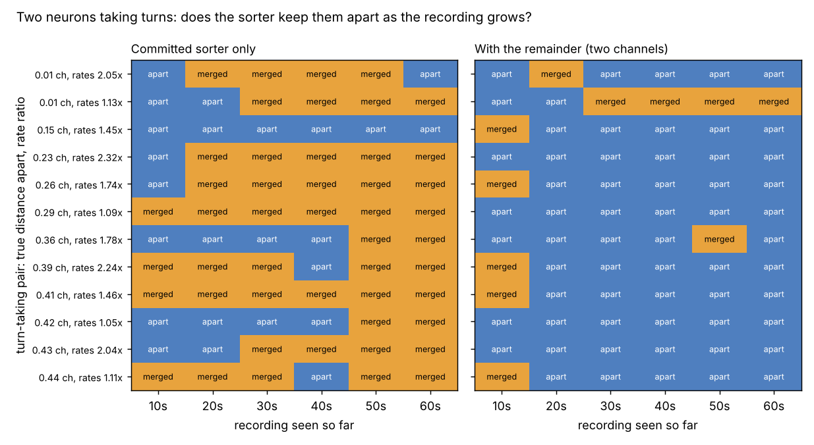

# SihtiSort

**A spike sorter that remembers the previous spikes.**

A neuron's spike is not a fixed stamp. Martin-Burgos, Juavinett, Rivière, Hammonds & Voytek ([bioRxiv, Sept 2026](https://doi.org/10.64898/2026.09.15.751814)) found that 30 of 40 neurons switch between distinct spike shapes, often abruptly, and that one cell's own spikes can differ more than two different cells do. A sorter that judges each spike alone splits such a neuron into two "units".

SihtiSort tests whether remembering fixes that. If two clusters sit at the same place on the probe, never fire too close together, and take turns in long blocks instead of interleaving, then the hypothesis is *one neuron in two moods*, and it becomes one address with two states.



*One mood-switching neuron (post-hoc sparse recording, seed 11). Top: the snapshot sorter spreads it across units. Middle: SihtiSort holds 627 of its 633 spikes at one address and decodes its state. Bottom: the truth.*

## Result, in one paragraph

**The preregistered test failed.** On the five test recordings, SihtiSort recovered 7 of 20 mood neurons as one unit, against 6 of 20 for the snapshot-plus-merge baseline; the gate needed +25 points. The post-hoc analysis says why: neurons were placed at random, and 14 of the 20 mood neurons had another neuron within half a channel. No sorter recovered those 14, and every sorter recovered the other 6, so the test set held almost no case where the idea could matter. On recordings with neurons at least one channel apart (post hoc, not a gate result), SihtiSort recovered **20/20** against **14/20**, and **10/10** strong mood neurons against **4/10**. Removing the temporal rule drops that to 3/10. False merges did not rise (2 vs 3).

## How it works

The vocabulary maps onto the conversation it came from: addresses that open and close, guesses that get falsified, and a residue that gets purified.

1. **First look.** Detect spikes and cluster each one as a snapshot (PCA plus a Gaussian mixture, with the number of clusters chosen by BIC). This is the baseline sorter.
2. **Same-shape merge.** Clusters at the same place with correlated templates and no refractory clash are joined. This is the standard auto-merge in current sorters.
3. **Hypothesis: same neuron, different state.** For two clusters at the same place, compute the *switch ratio* R: how often the time-ordered union changes label, divided by how often it would if the two trains interleaved independently. A neuron changing mood gave R = 0.01–0.08 in these recordings. Two independent neurons give R ≈ 1. If R ≤ 0.3 and the refractory check passes, they become two states of one address.
4. **The sieve.** Every spike is explained by its best (address, state) template and subtracted, leaving a residue. Detection runs again on the residue to find spikes that were hidden under others.
5. **Look again.** Each address is re-split on *purified* snippets: its own spike plus the residue, with the neighbours' spikes removed. Every part goes back through steps 2–3 as a new hypothesis.
6. **Open new addresses** from whatever nothing explained, if it behaves like a neuron.
7. **Memory.** Each address carries a belief about its own current state, which fades toward uncertainty over about 5 s. The belief biases the next assignment, and the final state sequence comes from Viterbi decoding.

Every hypothesis tested in steps 2, 3, 5 and 6 is written to a **ledger** with its numbers and verdict: "could it be this? no, they interleave. Could it be that? Yes."

## Scoring correction (11 Oct, found by Sol)

The protocol says spikes match ground truth one-to-one, but the first evaluator matched each true spike to its nearest sorted spike, so one sorted spike could be counted twice where spikes overlap. [diagnostics/rescore.py](diagnostics/rescore.py) reruns the sorters (they are deterministic) and scores them both ways: the old scoring reproduces the original files exactly, and the one-to-one scoring changes no gate verdict. Overlap recall falls (SihtiSort 0.82 → 0.78 on the test set), the test-set baselines gain two false merges, and stable accuracy moves by under 0.01. All tables below use one-to-one scoring; the original files `results/test.json` and `results/sparse_posthoc.json` are kept as they were, and `results/*_rescored.json` hold both versions.

## Preregistered test (seeds 0–4, frozen commit `5c2153c`, run once)

The gates are in [PROTOCOL.md](PROTOCOL.md), committed before any code existed.

| Sorter | Mood neurons as one unit | Strong | Mild | Stable accuracy | False merges | Overlap recall |
|---|---|---|---|---|---|---|
| B1 snapshot | 8/20 | 3/10 | 5/10 | 0.738 | 23 | 0.13 |
| B2 snapshot + standard merge | 6/20 | 2/10 | 4/10 | 0.613 | 20 | 0.25 |
| **S SihtiSort** | **7/20** | 3/10 | 4/10 | **0.772** | **14** | **0.78** |
| S − temporal rule | 5/20 | 1/10 | 4/10 | 0.772 | 14 | 0.76 |
| S − memory | 7/20 | 3/10 | 4/10 | 0.772 | 14 | 0.78 |
| S − sieve | 6/20 | 2/10 | 4/10 | 0.613 | 20 | 0.25 |

| Gate | Verdict |
|---|---|
| G0 the problem exists | **Fail.** B1 recovers 40% of mood neurons, under the 50% bar, but its stable accuracy is 0.74, under the 0.8 bar: the baseline itself struggles on these recordings. |
| G1 main claim (+25 points over B2) | **Fail.** +5 points. False merges (14 vs 20) and stable accuracy (0.77 vs 0.61) do meet their conditions. |
| G2 the temporal rule does the work | Pass (S − temporal rule 25% vs B2 30%), but with G1 failed there is little to attribute. |
| G3 memory improves state decoding on mild neurons | **Not testable.** No sorter ever split a mild neuron into states, so there was nothing to decode. On strong neurons, state accuracy is 0.98–1.0 with or without memory. |
| G4 turn-taking pair | Merged once, at 0.86 channels apart (seed 3); never at ≥ 1.25. That is close to the stated prediction (merge at ≤ ~0.75). |
| G5 sieve sanity | Pass: overlap recall 0.78 vs 0.25. This is matching pursuit, which is prior art. |

## Post-hoc analysis (after the failure, labelled as such)

**Crowding** ([diagnostics/crowding.py](diagnostics/crowding.py)). With 10 neurons placed at random on 16 channels, 14 of 20 mood neurons had a neighbour within 0.5 channel. The protocol said neighbours would be close "sometimes", but in practice that was the norm.

| Test mood neurons | n | B1 | B2 | S | S − temporal rule |
|---|---|---|---|---|---|
| Crowded (neighbour < 0.5 ch) | 14 | 2 | 0 | 1 | 0 |
| Isolated (≥ 0.5 ch) | 6 | 6 | 6 | 6 | 5 |

**Oracle front end** ([diagnostics/oracle_front_end.py](diagnostics/oracle_front_end.py)). The merges were handed perfect clusters: every test-set mood neuron arrives split into its two true states. The temporal rule rejoined **14/20**, against 10/20 for the same-shape rule alone, and added **no** false joins (11 in both cases, all from the same-shape rule). Each of the 6 it missed has another neuron within 0.3 channel.

**Sparse recordings** (seeds 10–14, every neuron ≥ 1 channel from the others except the designed turn-taking pair; `python run_gates.py sparse_posthoc`):

| Sorter | Mood as one unit | Strong | Mild | Stable accuracy | False merges |
|---|---|---|---|---|---|
| B2 snapshot + standard merge | 14/20 | 4/10 | 10/10 | 0.887 | 3 |
| **S SihtiSort** | **20/20** | **10/10** | 10/10 | **0.986** | 2 |
| S − temporal rule | 13/20 | 3/10 | 10/10 | 0.986 | 2 |
| S − sieve | 19/20 | 9/10 | 10/10 | 0.887 | 3 |

Here the temporal rule is what recovers the strong mood neurons: 3/10 without it, 10/10 with it, and 9/10 even without the sieve. Mild moods were never split in the first place. The turn-taking pair (0.81–1.92 channels apart) was never merged.

## What the memory did

Almost nothing measurable. Each spike carries strong evidence about its own state, so the remembered state only decides near-ties. State accuracy on strong neurons in the sparse set is 0.994 with memory and 0.993 without. Memory should matter where single spikes are ambiguous: lower amplitudes, more similar moods, or real noise. These recordings don't contain that case.

## Deviations from the protocol

All were made on calibration seeds 100–102, before the frozen commit.

1. **Sieve acceptance.** The protocol's rule, "removes ≥ 50% of the snippet energy", rejected every spike that had another spike in its window. It was replaced by "removes ≥ 50% of the fitted template's own energy". Before the change, about 10% of every neuron's spikes went unexplained.
2. **"Look again" step added** (step 5 above). Without it, mood states arrived mixed with neighbouring neurons and the temporal test saw interleaving.
3. Residue clustering was allowed 1–10 clusters; the protocol did not fix this.
4. A peak-channel local-clustering front end was tried and removed, because it produced more false merges.

## What this is not

- **Synthetic.** The mood model is one reading of one preprint: two states, exponential dwell times around 8 s, firing rate independent of mood.
- **Not new machinery, except one test.** Residue subtraction is matching pursuit, as in current template-matching sorters. Refractory and cross-correlogram merges and drift correction exist in current sorters too. I have not checked whether any sorter already models within-unit waveform states over time. The switch-ratio test and the state-aware addresses are the parts specific to this repository.
- **Identifiability limit.** From spikes alone, "one neuron with two moods" and "two neurons at the same place taking turns" can look the same. The footprint is the only separator, and it fails below roughly one channel of separation.

## Commit, name the refuter, revise ([PROTOCOL_2.md](PROTOCOL_2.md))

Antti's bike ride: two coloured shapes far ahead became "two cyclists" at once, then "two signs" as he rode closer. The brain didn't say "I can't tell". It committed and stayed open to correction. So every "one neuron, two states" merge became a **commitment** carrying three things: a confidence (a runs test on the state sequence), a named **refuter** (one neuron keeps its firing rate across waveform states, per the preprint's η² = 0.013, so a ≥ 1.5× rate gap at z ≥ 3 means two neurons), and a status of *survived*, *refuted* (the address is split) or *untested from here* (with the extra recording time needed).

One design change was made on calibration seeds 40–41, before the frozen commit `af952bc`. The close turn-taking pair was never a two-state hypothesis, because the same-shape rule swallowed it. In commit mode, same-shape parts that take turns are now handed to the state rule. Protocol 2's thresholds are unchanged.

**Identifiability set** (seeds 20–31: neurons ≥ 1 channel apart, except the turn-taking pair, placed 0–0.5 channels apart):

| Gate | Result |
|---|---|
| R1 catches the false merge (pairs with true rate gap ≥ 1.5×) | **Fail.** Two merged pairs had a rate gap that large (2.0× and 2.7×), and neither ever became a two-state hypothesis. The first clustering lumped each pair together, and the look-again step didn't split it. A refuter only works on a hypothesis that exists. |
| R2 doesn't destroy true merges | **Pass.** 0 of 30 true mood merges wrongly split. |
| R3 "survived" means something (≥ 90% correct) | **Fail.** 29 of 34 correct (85%). All 5 wrong ones are turn-taking pairs whose rates differ by ≤ 1.37×. The rate refuter cannot see them, so "survived" overstated what was tested. |
| R4 the bike ride | **No revision ever happened.** The refuter never fired. Commitments reached "survived" after 20–55 s of recording. |

On the earlier sets nothing regressed: mood neurons kept as one unit stayed at 7/20 (test) and 20/20 (sparse), and sparse false merges went from 2 to 1.

**The lesson, which is the bike ride's too:** surviving a test that can't see the difference is not evidence. From half a mile away, "two cyclists" survives every look, because distance can't separate a cyclist from a sign. The refuter has to be one that can actually tell the alternatives apart.

**Post hoc: a position refuter** ([diagnostics/position_refuter.py](diagnostics/position_refuter.py), threshold not fixed in advance, n small). One neuron in two states sits at one place; two neurons sit at two. Each state's position was estimated as the amplitude-weighted channel centroid of its median spike:

| Commitments on the identifiability set | Gap between the two states' positions (channels) |
|---|---|
| 30 true one-neuron merges | median 0.024, max 0.097 |
| 6 true two-neuron merges (true offset → measured gap) | 0.32 → 0.30, 0.25 → 0.27, 0.23 → 0.27, 0.16 → 0.10, 0.12 → 0.09, 0.00 → 0.01 |

The three pairs ≥ 0.23 channels apart sit well clear of every one-neuron merge. The pairs at 0.12–0.16 channels overlap the one-neuron spread, and the pair at 0.00 is truly identical from here. So "getting closer" means sub-channel position, and below about a tenth of a channel this probe cannot tell; a denser probe could.

## Two channels: a committed address and a remainder ([PROTOCOL_3.md](PROTOCOL_3.md))

Protocol 2 failed because the alternative "two neurons" was erased before any refuter could look, as Sol pointed out. The J-space paper (Gurnee et al. 2026, §4.1.1) shows a language model doing better. Given an ambiguous input, its workspace commits to one reading while the rest of the activation still carries the unresolved mixture, for a while. So SihtiSort now keeps two channels:

1. **The committed address**, which it acts on.
2. **A remainder**: every address keeps a split of itself alive. For a two-state address that is its states; for a one-state address it is a forced two-way split of its purified spikes. The split is fitted on half the spikes and tested on the other half, so it cannot manufacture the difference it is tested for.

The remainder is tested for *position* (do the two parts sit ≥ 0.15 channels apart, at z ≥ 3?) and, when the parts take turns, for *rate*. If either fires, the address is **reopened** into two. The whole pipeline is rerun on the first 10, 20, … 60 s of each recording, with no access to later data, so each column below is what the sorter believed at that moment.



Two design changes were made on calibration seeds 70–71, before the frozen commit `9f762e7`. Per-spike position estimates were biased toward the probe centre for small spikes, which made a neuron's quieter mood look as if it had moved, so position now uses averaged spikes with a bootstrap error. The forced split uses 5 restarts. The thresholds are unchanged.

**Fresh identifiability set** (seeds 50–61, run once):

| Gate | Result |
|---|---|
| P1 reopens false merges that can be seen (offset ≥ 0.25 ch or rate gap ≥ 1.5×) | **Pass.** 9 of 9 separated at 60 s. |
| P2 keeps true mood merges (drop ≤ 1) | **Pass.** 46 → 45. |
| P3 doesn't shatter single neurons (drop ≤ 2) | **Pass.** 48 → 48. |
| P4 revises online without flip-flopping back | **Condition failed.** 7 pairs were merged early and separated later, most of them merged at 10 s and apart from 20 s on. But one pair (0.01 channels apart, rates 1.13×) was apart at 10–20 s and merged from 30 s on. |
| P5 what it can't see | Only that same pair stays merged. Its remainder said *agrees* (since renamed *no contradiction at tested resolution*, see below): position gap 0.03 ± 0.02 channels and similar rates. Neither refuter can see a pair at the same place firing at the same rate. |

Two things in the picture are worth saying plainly:

- **The committed sorter alone gets *more* wrong as data arrives.** In 6 of the 12 rows it starts "apart" and ends "merged": more spikes make the turn-taking look more convincing. Persistence is not confirmation.
- **The remainder moves the other way.** Its early mistakes at 10 s are corrected by 20 s and stay corrected.

The other sets were run with the full recording only, post hoc. On the crowded test set the remainder helps: stable neurons recovered as one unit go from 11 to 17 of 20, mood neurons from 7 to 8, and false merges from 14 to 11. On the sparse set nothing is reopened and nothing changes.

## The drift control ([PROTOCOL_4.md](PROTOCOL_4.md), Sol's suggestion)

Real probes drift relative to the tissue. One neuron's early spikes then sit somewhere else than its late spikes, and if its moods occupy different stretches of time, its two states sit at different average places. That is exactly what Protocol 3's position check reads as "two neurons", but the right answer is still one neuron. So the generator now moves the whole probe by 0.6 channels over the 60 s, and moods and turn-taking blocks last about 20 s.

The fix tested here compares the two parts **only at matched times**: within 15 s windows that contain both, then averaged. Both versions run on the same sorting. The remainder status "agrees" is now called **"no contradiction at tested resolution"**, because the old label overstated what a test had shown.

| Gate | Result |
|---|---|
| D0 the danger is real | **Yes, badly.** Naive position check: 40 false reopenings in 12 recordings; mood neurons kept as one unit 47 → 30, stable 48 → 32. |
| D1 drift-aware keeps true neurons (≤ 1 false reopening, mood drop ≤ 1, stable drop ≤ 2) | **Fail.** False reopenings 40 → 5, mood 47 → 47, but stable 48 → 44. |
| D2 drift-aware still separates the false merges it can see | **Pass.** 4 of 5. |
| D3 no regression without drift (seeds 50–61) | **Pass.** 9 of 9 separated, mood 46 → 45, stable 48 → 48. |

The 5 remaining false reopenings are all forced splits with gaps of 0.16–0.19 channels, just over the 0.15 threshold. Inside one 15 s window the probe still moves 0.15 channels, so a split into earlier and later spikes within the window still looks like two places. Matching times removed most of the confusion but not all of it. The standard next step, used by current sorters, is to estimate the probe's drift from all neurons together (it is shared) and subtract it before any position test. Turn-taking pairs whose blocks never share a window get a silent position test. One such pair (0.39 channels apart, rates 1.05×) stays merged.

## Correct the frame, or compare at the switch ([PROTOCOL_5.md](PROTOCOL_5.md))

Two ways out of Protocol 4's failure were tested on 36 fresh recordings, run once:

- **Correct the frame (Sol).** Probe drift is shared by every neuron, so estimate it from the whole sorted population, blind, and subtract it. Two controls: the true drift from the simulator, and a deliberately wrong one (the estimate reversed in time).
- **Compare at the switch.** Norman-Haignere et al. (Nature Neuroscience 2025) found that auditory cortex integrates over fixed absolute time, not over speech structure. Protocol 4's 15 s window was time-yoked in the same way. The structure-yoked alternative compares the ≤ 15 spikes on each side of every moment the two parts hand over to each other. Across that instant the probe has barely moved.

False reopenings of true neurons, and separable false merges that end up apart:

| Method | Linear drift (0.6 ch / 60 s) | Sine drift (±0.3 ch, 40 s period) | No drift |
|---|---|---|---|
| naive (Protocol 3) | 44 false · 5/6 | 45 false · 3/3 | 0 · 8/9 |
| window (Protocol 4) | 5 false · 5/6 | 31 false · 3/3 | 0 · 8/9 |
| frame, true drift | **0** · 6/6 | 5 false · 3/3 | 0 · 8/9 |
| frame, estimated drift | **0** · 6/6 | 10 false · 3/3 | 0 · 8/9 |
| frame, wrong drift (control) | 54 false · 4/6 | 41 false · 3/3 | 0 · 8/9 |
| switch | **0** · 4/6 | **0** · 2/3 | 0 · 7/9 |
| switch + estimated frame | **0** · 4/6 | **0** · 3/3 | 0 · 7/9 |

| Gate | Result |
|---|---|
| F1 estimated frame passes all three sets | **Fail.** It passes linear and no-drift, but makes 10 false reopenings under sine drift. |
| F2 switch passes all three sets | **Fail.** Zero false reopenings in all 36 recordings, but it separates only 4/6 (linear) and 2/3 (sine), under the 70% bar. |
| F3 the wrong correction does damage | **Pass.** 54 false reopenings, more than no correction at all, so the correction is doing real work. |
| F4 the true drift passes linear and sine | **Fail.** It passes linear but makes 5 false reopenings under sine drift. |

The blind drift estimate was accurate: within 0.013–0.030 channels of the truth (linear) and 0.027–0.049 (sine). So the sine failure is not mainly an estimation failure: even the *true* drift fails there. Correction (Sol): that shows a limit of *this* oracle, not of motion correction. The code averages a part's spikes first and only then subtracts the mean drift from the averaged footprint's centroid. When the probe moves quickly, the averaged footprint is already blurred, differently for each part. Registering each spike before averaging, as current sorters do, has not been tested.

A second caveat (also Sol's): the switch comparison takes up to 15 spikes on each side, which at 3 Hz can span about 5 s. Under the sine drift (up to 0.047 channels/s) that is room for about 0.24 channels of motion. So "the probe has barely moved across a switch" is not guaranteed by the code. The measured zero false reopenings still stand, but the elapsed time inside each comparison has not been measured.

**The two fixes fail in opposite directions.** Frame correction finds every separable pair but can split a true neuron when the probe moves fast. The switch comparison never split a true neuron in any of the 36 recordings, drift or not, but it needs handovers with at least 6 spikes on each side, so it misses some real pairs. Combined, the switch comparison with the estimated frame passed the sine and no-drift sets and failed linear on recall alone (4 of 6). No single method passed all three sets.

## Register each spike first ([PROTOCOL_6.md](PROTOCOL_6.md), Sol's suggestion) — and a replication

Sol pointed out that Protocol 5's "true drift" check averaged spikes *before* correcting them. Current sorters move each spike back into place first. Protocol 6 tested that order on 36 new recordings, run once, with the same generator settings as Protocol 5. Same cell format: false reopenings of true neurons, then separable false merges that end up apart.

| Method | Linear drift | Sine drift | No drift |
|---|---|---|---|
| frame, true drift, centroid (Protocol 5's version) | 2 · 4/6 | **0** · 6/6 | 2 · 4/5 |
| frame, true drift, registered per spike | 2 · 4/6 | 5 · 6/6 | 2 · 4/5 |
| frame, estimated drift, centroid | 1 · 5/6 | 4 · 6/6 | 2 · 4/5 |
| frame, estimated drift, registered | 2 · 5/6 | 11 · 6/6 | 2 · 4/5 |
| frame, wrong drift, registered (control) | 46 · 5/6 | 41 · 6/6 | 2 · 4/5 |
| switch | 1 · 3/6 | 6 · 5/6 | 2 · 3/5 |

| Gate | Result |
|---|---|
| G1 registering first fixes the sine failure | **Fail.** With the true drift, registering each spike made *more* false reopenings under sine drift (5) than averaging first (0). |
| G2 estimated drift + registration passes all sets | **Fail.** |
| G3 the wrong correction does damage | **Pass.** 46 false reopenings. |

**Protocol 5 did not replicate.** On these new recordings the true-drift centroid method, which failed the sine set before (5 false reopenings), made none. The switch comparison, which made none in all 36 Protocol 5 recordings, made 9 here (1, 6 and 2).

With 12 recordings per set, counts of 0–6 false reopenings move around from batch to batch by about as much as the differences between methods. The method comparisons drawn from Protocol 5 were within that noise. What has held in every batch is the large effect: comparing positions without accounting for drift gives about 40–50 false reopenings, and so does a deliberately wrong correction. Any method that accounts for drift, by any of these routes, gives roughly 0–11.

Where the remaining errors come from:

- **Almost every false reopening was a forced split.** Leaving out the wrong-drift control, 42 of 44 were. Those triggered by position had gaps just above the threshold, 0.15–0.23 channels (one at 0.42). The forced split is fitted to the data, and under drift its two halves differ by about the threshold, so the 0.15-channel threshold sits inside the noise of that split.
- **The 2 false reopenings without drift come from the rate refuter**, again on forced splits, as Sol warned. Fixing position cannot remove them.
- **The switch comparisons are not instants.** Measured spans: median about 4 s, 95th percentile 11–12 s, longest 19 s. Under sine drift that is enough motion to explain its 6 false reopenings there.
- **Why per-spike registration hurt is not established.** One untested suspect is the linear interpolation between channels: it smooths a footprint by an amount that depends on the fractional shift, and that changes the centroid.

Before comparing these methods further, the sets need to be several times larger, and the forced split needs its own, stricter evidence bar.

## Two cheap diagnostics (after Protocol 6, Sol's questions)

[diagnostics/null_split.py](diagnostics/null_split.py) involves no sorting and no gates; it is a direct measurement of two suspects.

**A. Is interpolation to blame for registration doing worse?** No. On noise-free spikes at known positions and known shifts (positions 5.0–6.0 channels, shifts −0.6 to +0.6):

| Correction | Position error, RMS | Worst case |
|---|---|---|
| centroid minus drift (Protocol 5) | 0.028 channels | 0.063 |
| registered by interpolation (Protocol 6) | 0.010 channels | 0.022 |

Registration is the more accurate of the two. So why it did worse under sine drift in Protocol 6 remains unexplained, and may be noise.

**B. Does the forced split invent a second neuron?** One neuron with 400 noisy spikes, 150 trials per row, run through the exact remainder procedure. "False reopen" means the position check fired (gap ≥ 0.15 channels with z ≥ 3):

| Condition | Spike size 7 (small) | Spike size 12 |
|---|---|---|
| no drift | 0.7% false reopen (median gap 0.035) | 0.0% (0.024) |
| drift 0.6 channels, no correction | 32% (0.119) | 88% (0.324) |
| drift, centroid corrected by the true drift | 9.9% (0.067) | 2.0% (0.091) |
| drift, registered by the true drift | 8.5% (0.071) | 0.0% (0.065) |

- **Without drift, Sol's selection effect is real but small** at these spike sizes, at most 0.7% per split.
- **With drift, the forced split mostly cuts along time**, into early and late halves, because drift is the largest variation in the spikes. Even with the true drift removed, what is left still crosses the threshold for about 1 in 10 small neurons. With roughly ten addresses per recording, that is about one false reopening per recording, in line with the full runs.
- **The z-score is not trustworthy here.** Under the one-neuron null with true-drift correction, z ≥ 3 occurs in 18–69% of trials. The bootstrap error ignores how the split was chosen, exactly as Sol argued. Only the 0.15-channel floor was protecting the decision.
- **The bar should depend on spike size.** The 95th-percentile null gap is about 0.17–0.18 channels for small spikes and 0.12–0.14 for large ones.

So Sol's proposed fix is the right one: judge each forced split against a null distribution of what the whole procedure produces from one neuron of that size, under the measured drift. A fixed threshold plus a bootstrap z-score is not enough.

## The test that matters next

The preprint's **spe-1** dataset ([CRCNS](https://crcns.org/), analysis code at [voytekresearch/spikewise](https://github.com/voytekresearch/spikewise)) has simultaneous intracellular ground truth beside the Neuropixels recording. For the cells whose waveform switches state, the question is whether a sorter that remembers keeps each one as one unit where snapshot sorting splits it. Download needs a CRCNS account, and this repository does not include a loader yet.

## Run

```bash
pip install -r requirements.txt
python -m pytest -q tests
python run_gates.py calibration      # seeds 100-102 (~1.5 min)
python run_gates.py test             # seeds 0-4, the preregistered test (~2.5 min)
python run_gates.py sparse_posthoc   # seeds 10-14, post hoc (~2.5 min)
python diagnostics/oracle_front_end.py
python diagnostics/crowding.py
python diagnostics/figure_timeline.py
python diagnostics/rescore.py         # one-to-one rescoring (~5 min)
python diagnostics/commit_and_revise.py    # PROTOCOL_2 (~9 min)
python diagnostics/position_refuter.py     # post hoc (~3.5 min)
python diagnostics/two_channel.py          # PROTOCOL_3 (~45 min on 2 cores)
python diagnostics/figure_two_channel.py
python diagnostics/drift_control.py        # PROTOCOL_4 (~12 min on 2 cores)
python diagnostics/frame_or_switch.py      # PROTOCOL_5 (~30 min on 2 cores)
python diagnostics/register_first.py       # PROTOCOL_6 (~30 min on 2 cores)
python diagnostics/null_split.py           # diagnostics A and B (~4 min)
```

Files: [sihtisort/synth.py](sihtisort/synth.py) (recording and ground truth) · [sihtisort/sort.py](sihtisort/sort.py) (B1, B2, SihtiSort) · [sihtisort/evaluate.py](sihtisort/evaluate.py) (scoring) · [run_gates.py](run_gates.py) · `results/*.json` (every number above, with the ledger of every hypothesis tested).
